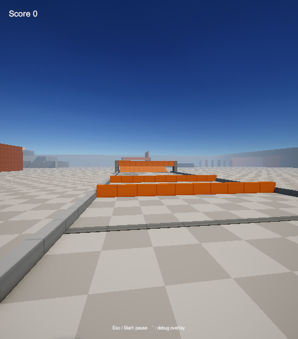

# OOO

A first-person "metroidbrainia": escape an impossibly vast, empty midcentury-modern brutalist office. Progress is gated only by knowledge. Nothing is explained. There is no HUD and no fail state.


**Play it:** open the project in Unity 6000.6.4f1, open `Assets/_Project/Scenes/Boot.unity`, and press Play, then Play on the title screen. The world is generated: after changing a builder, run **Kit > Build Office** (and **Kit > Rebuild Kit Assets** for the UI and prefabs).

**Controls (keyboard / gamepad):**

| Action | Keyboard | Gamepad |
| --- | --- | --- |
| Move | WASD | left stick |
| Look | mouse | right stick |
| Jump | Space | A |
| Sprint | Shift | left stick press |
| Slide | Ctrl or C | B |
| Interact (take or place a letter tile) | E | X |
| Pause | Esc | Start |

Movement is Source-style: bunny hops, air strafing, slides, slide-jumps, wall runs, wall jumps and surfing on steep ramps.

**Docs:**
- [docs/GDD.md](docs/GDD.md): the design. [docs/ARCHITECTURE.md](docs/ARCHITECTURE.md): systems, world layout and the door-number plan.
- [docs/DECISIONS.md](docs/DECISIONS.md): every choice and deviation. [docs/WORKPLAN.md](docs/WORKPLAN.md): who built what. [docs/MORNING_REPORT.md](docs/MORNING_REPORT.md): the overnight build report.
- Screenshots are in `docs/shots/`.

<details><summary>Spoiler: how the building works, and the way out</summary>

Two numbered openings showing the same number are the same opening: go in one and come out of the other, keeping your speed. Exactly two must match (three cancel out). Letterboard plates have movable tiles (Interact), so you can rewire the building. The building reads the letter O as the digit 0.

The way out: an outside door reads 000. You can see it from the executive boardroom, which you reach by dropping down the stair core into hatch 6. Take three letter O's (from "OUT OF OFFICE" on the lobby directory, reached by a wall run along the south wall, or from the cafeteria menu), press them into the blank plate over the lobby cloakroom door, and walk through.

The fastest route: in the waiting room, step through reception door 1, which is paired with the lobby's front door 1.
</details>

---

# Unity Prototype Kit

A Unity 6 (6000.6.4f1, URP, 3D) template

It ships with a first-person controller, a pastel greybox kit built to real dimensions, Source-style movement (bunny hopping, air strafing, surfing) with slides and wall runs, and a walled obstacle-course Sandbox to test it in.



## 1. Host
1. Push this kit to GitHub:
   ```bash
   git remote add origin https://github.com/<owner>/unity-prototype-kit.git
   git push -u origin main
   ```
2. On GitHub, open **Settings > General** and tick **Template repository**.
3. `.gitignore` already keeps `Library/`, `Temp/`, `Logs/` and `obj/` out of the repo. Git LFS is used for binary art (`git lfs install` once per machine).

## 2. New prototype
1. On GitHub, click **Use this template**, or run:
   ```bash
   gh repo create <name> --template <owner>/unity-prototype-kit --private --clone
   ```
2. Open the clone once in Unity Hub with **6000.6.4f1** so `Library/` generates.
3. In Unity, open **Window > MCP for Unity > Connect** and click **Start Server** (transport: HTTP Local). Claude Code reaches it through `.mcp.json` as **UnityMCP**.
4. Open `Assets/_Project/Scenes/Boot.unity` and press Play to check that the kit works.

## 3. Brief
Write the one-paragraph brief into `docs/BRIEF.md`.

Optionally, drop reference images into `docs/references/` and add a section for each in `docs/references/REFERENCES.md`: what it's for, what to pay attention to, and what to ignore.

## 4. Start
Open Claude Code in the repo root and say:

> Read CLAUDE.md and docs/WORKFLOW.md, then run phase 1 on docs/BRIEF.md.

`CLAUDE.md` loads automatically. The workflow takes it from there and stops for owner review after the GDD.

## Useful commands
- Rebuild generated assets: Unity menu **Kit > Rebuild Kit Assets**.
- Offline compile check (Editor closed): `powershell -File Tools/compile-check.ps1`
- Offline tests (Editor closed): `powershell -File Tools/run-tests.ps1`
